# AniSync — Otaku Mahallesi

Anime, manga, novel ve oyun sevenlerin **aynı masada** buluştuğu sıcak bir dijital mekân.
Bu depo, ilk sürümün (v1) yeniden kurgulanmış hâli: aynı fikir, ama artık kullanılabilir bir ürün.

> v1: 100+ bileşen, 11 maddelik alt menü, çoğu birbirinden habersiz özellik, örnek veriler.
> v2: 5 sekme, tek tasarım dili, 4 atmosfer, seviye mekaniği, gerçek veri kaynakları, mobil öncelikli.

Canlı (eski sürüm): https://anisync-tau.vercel.app/ · Yeni sürümü yayınlamak için aşağıdaki **Yayın** adımına bak.

<p align="center">
  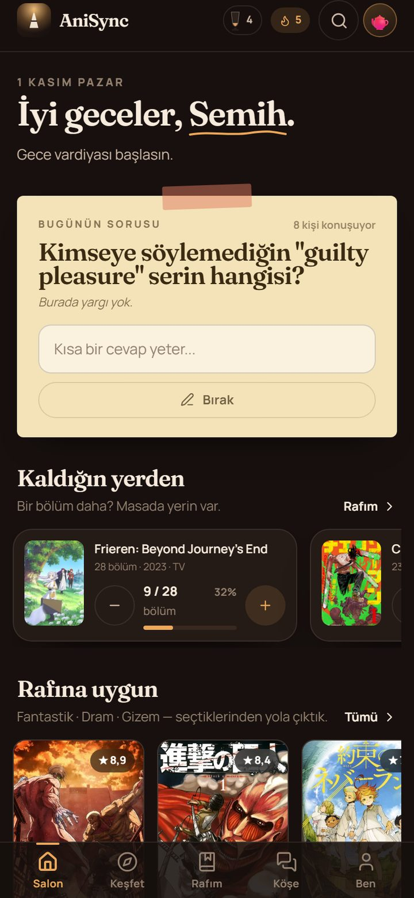
  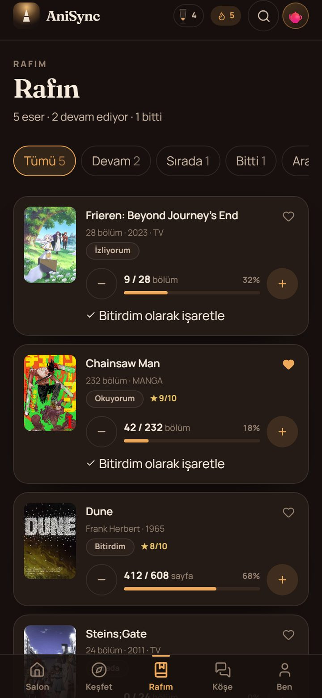
  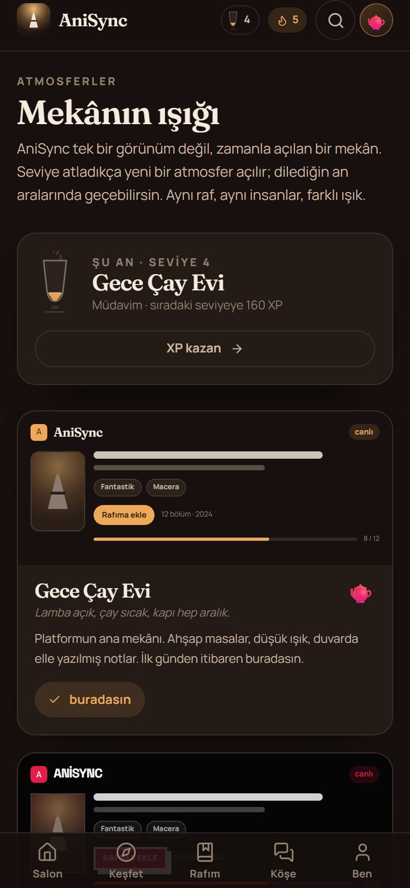
</p>

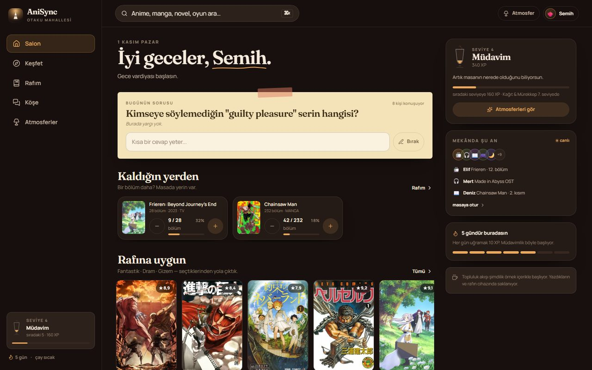

> Varsayılan görünüm v1'in **AniSync Klasik** teması. Sıcak **Gece Çay Evi** seviye 2'de, sinema seviye 4'te, kütüphane seviye 7'de açılıyor.

Aynı bileşen ağacı, dört mekân — ve Klasik'in içinde beş zaman paleti:

| AniSync Klasik | Kağıt & Mürekkep |
| --- | --- |
| 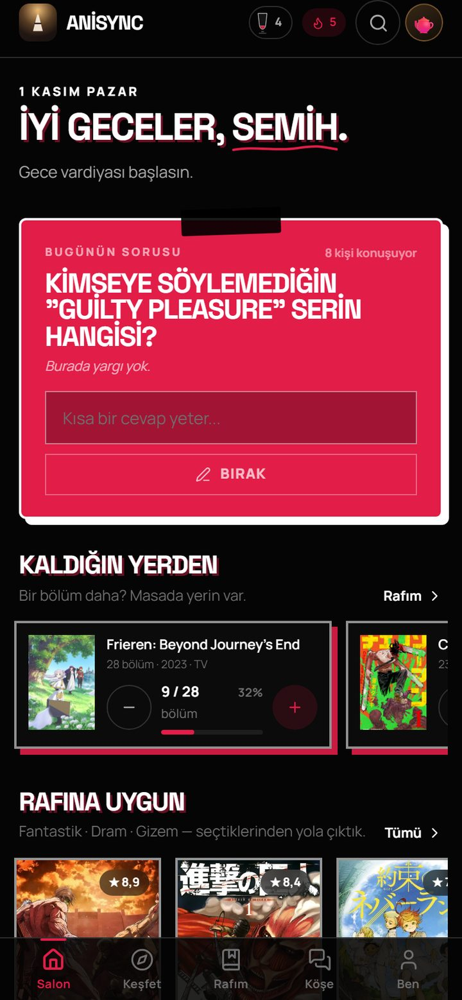 | 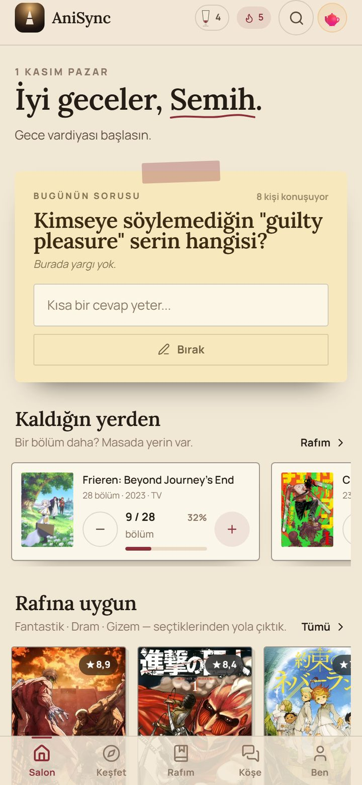 |

---

## 1. Fikir: neden "mekân"?

Çoğu anime platformu bir **veritabanı**: listeler, puanlar, sezonluk tablolar. AniSync bir **yer** olmayı deniyor.
Kapıdan giriyorsun, lamba yanıyor, çay sıcak, masada tanıdık yüzler var. Kimse "kaç bölüm izledin" diye yargılamıyor;
biri "Frieren'i bitirdim, boşluktayım" diyor, biri "ben de" diyor.

Bu yüzden ürün kararları "daha çok özellik" değil, **daha çok aidiyet** üzerine kurulu:

- Sert, neon, siyah-kırmızı bir arayüz yerine **sıcak, loş, ahşap ve kâğıt** hissi.
- Sonsuz akış yerine **beş net oda**: Salon, Keşfet, Rafım, Köşe, Ben.
- Oyunlaştırma bir süs değil: **mekân seninle büyüyor.** Seviye atladıkça yeni bir atmosfer açılıyor.
- Veri girişi değil, **kayıt tutma**: "9/28 bölüm" demek, o hikâyenin neresinde olduğunu bilmek.

---

## 2. Beş oda

| Oda | Ne işe yarar | Öne çıkan |
| --- | --- | --- |
| **Salon** | Günün ilk ekranı. Selamlama, günün sorusu, kaldığın yer, öneriler, mekânda kim var | Kâğıt not üzerinde günün sorusu, "kaldığın yerden" hızlı ilerletme |
| **Keşfet** | Anime / manga / novel / oyun tek arama | Tür filtresi, sezon, küratörlü oyun masası, anlık arama |
| **Rafım** | Takip: izliyorum / okuyorum / oynuyorum / sırada / bitti | Durum filtreleri, arama, sıralama, toplu işlem, MAL/AniList içe aktarma, özel listeler, puan, favori |
| **Köşe** | Topluluk: 6 masa, gönderi, yanıt, spoiler etiketi | Masaya katılma, tür etiketli paylaşım, spoiler bulanıklığı |
| **Ben** | Profil, seviye, rozetler, ayarlar | Çay bardağı seviye göstergesi, yedek al/yükle, tema tercihleri |

Ekranlar: `src/pages/`. Kabuk ve gezinme: `src/components/AppShell.tsx`.

Mobilde alt menü 5 sekme; masaüstünde sol raf. Klavye kısayolu: `Ctrl/Cmd + K` → arama.

### Yedekten içe aktarma

**Rafım → İçe aktar**: MyAnimeList XML veya AniList JSON yedeğini dosyadan ya da yapıştırarak al.
MAL kayıtları AniList'in `idMal` eşlemesiyle kapak, özet ve doğru kimlikle zenginleştirilir; mevcut rafın korunur.

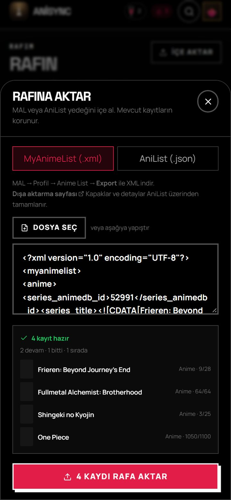

---

## 3. Atmosfer mekaniği (ürünün imzası)

Tek bir bileşen ağacı var; **dört mekân** aynı ağacı giydiriyor. Klasik ayrıca günün saatine göre **beş renk paleti** kullanıyor. Renk, tipografi, köşe yarıçapı,
gölge sertliği, doku — hepsi CSS değişkeni (`src/styles.css`). Bileşenler tema bilmez, sadece token kullanır.

| Atmosfer | Karakter | Açılış |
| --- | --- | --- |
| **AniSync Klasik** | v1'in **birebir** kimliği: 20px nokta ızgara, 28 sn renk döngüsü, 4px sert gölge, beyaz şeritli kartlar | Seviye 1 |
| **Gece Çay Evi** | Krem/kehribar, serif başlıklar, yumuşak gölge, lamba ışığı | Seviye 2 |
| **Mahalle Sineması** | Kadife kırmızı, sarı bilet, sıkıştırılmış büyük harf tipografi | Seviye 4 |
| **Kağıt & Mürekkep** | Aydınlık kâğıt, bordo mürekkep, ince çizgi, Lora | Seviye 7 |

**Klasik içindeki zaman paletleri** (v1 sistemi: `--theme-accent`, `--theme-secondary`, `--theme-glow`, `--theme-shadow`):

| Palet | Saat | Renk |
| --- | --- | --- |
| 🌅 Tokyo Şafağı | 06:00 – 11:59 | `#f59e0b` / `#ea580c` |
| ☀️ Akihabara Öğlesi | 12:00 – 17:59 | `#e11d48` / `#ffffff` |
| 🌇 Shinjuku Alacakaranlık | 18:00 – 21:59 | `#d946ef` / `#a855f7` |
| 🌙 Neo-Tokyo Gece | 22:00 – 05:59 | `#06b6d4` / `#10b981` |
| 💡 Yüksek Kontrast Işık | manuel | `#000000` / `#ffffff` |

Otomatik mod açıkken saat 06/12/18/22'de palet kendiliğinden değişir; seçim `anisync_time_theme` / `anisync_auto_theme` anahtarlarında saklanır.

### Hareketli RGB ışıma

Klasik'in arka planı v1'deki gibi: **20 px nokta ızgarası** + ekranın üstünden yayılan ve **28 saniyede** kırmızı → mor → camgöbeği → yeşil dönen ışık. Işıma, `--theme-glow` değişkeninin `subtleRgbGlow` animasyonuyla sürülür; palet seçimi vurgu rengini, bu animasyon ise ortam ışığını yönetir.

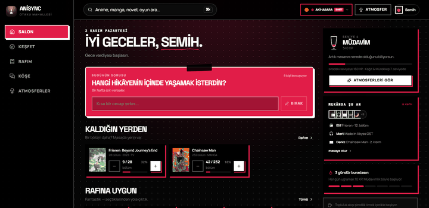

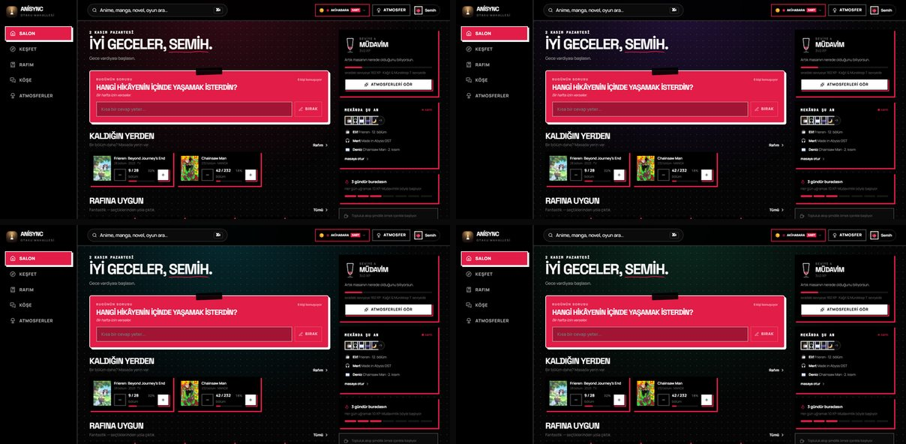

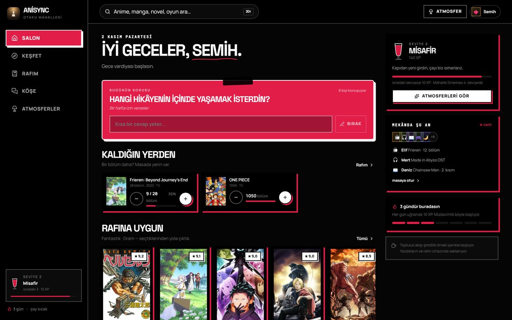

| Zaman paletleri | Listeler |
| --- | --- |
| 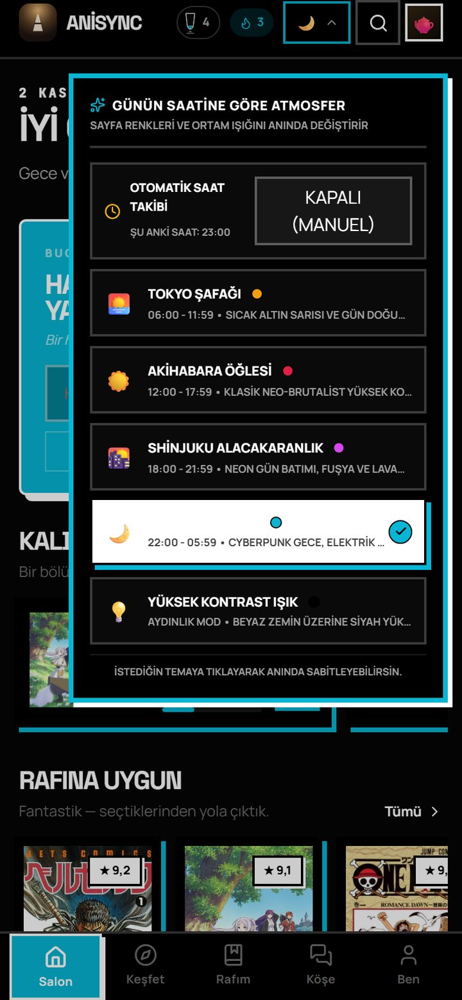 | 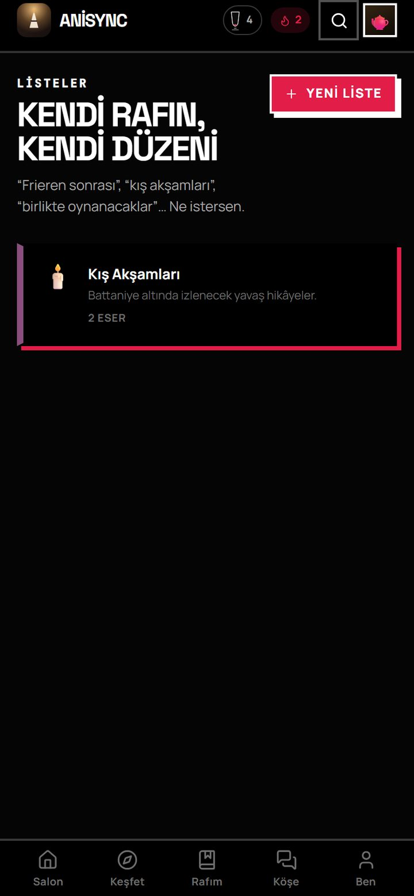 |

**Kilitli atmosferi 12 saniye deneyebilirsin.** Beğenirsen seviyeyi beklersin; bu, merakı ödüllendiren küçük bir oyun.

### Seviye eğrisi

```
L seviyesine ulaşmak için gereken toplam XP = 25 × (L−1) × L
L2 = 50 · L3 = 150 · L4 = 300 · L5 = 500 · L6 = 750 · L7 = 1050 · L8 = 1400
```

| Eylem | XP |
| --- | --- |
| Günlük uğrayış | +10 (seri bonusu ayrı) |
| Rafa eser ekleme | +15 |
| Bölüm/cilt/sayfa/saat ilerletme | +4 |
| Bir eseri bitirme | +40 |
| Puan verme | +6 |
| Favoriye alma | +5 |
| Gönderi paylaşma | +20 |
| Yanıt yazma | +8 |
| Köşeye katılma | +12 |

Rütbeler: Misafir (1) → Müdavim (3) → Kalfa (5) → Usta (7) → Mekân Sahibi (10) → Efsane (15).
Formüller `src/lib/level.ts` içinde; tek yerden ayarlanabilir.

**Çay bardağı**: seviye ilerlemesi düz bir çubuk değil, dolan ince belli bir bardak (`TeaMeter.tsx`).
Doluluk arttıkça buhar azalır. Bu, ürünün en küçük ama en "AniSync" detayı.

---

## 4. Veri katmanı

| Tür | Kaynak | Not |
| --- | --- | --- |
| Anime / Manga | [AniList GraphQL](https://anilist.co) | Anahtar gerekmez, CORS açık, trend + arama + öneri |
| Novel | [Open Library](https://openlibrary.org) | Haftalık trend + arama + kapak |
| Oyun | Steam mağaza aramasından üretilmiş **41 oyunluk küratörlü katalog** | `src/data/games.ts`, çevrimdışı çalışır |

Hepsi tek bir `Media` modeline indirgeniyor (`src/lib/types.ts`), böylece arayüz kaynağı bilmiyor.
İstekler **9 sn timeout**'lu; biri yavaşsa sayfa beklemiyor, yerel seçki devreye giriyor
(`src/data/fallback.ts`, `seasonFallback.ts`). Sonuçlar 10–30 dk bellek içi önbellekte.

Yeni kaynak eklemek: `src/lib/api/` altına `searchX` + `detailX` yaz, `src/lib/api/index.ts` içindeki
`searchMedia`/`getDetail` dağıtıcısına bağla. Arayüzde değişiklik gerekmez.

---

## 5. Yerel veri, hesap yok (şimdilik)

Bu sürüm **local-first**: hesap açmadan denersin, her şey cihazda kalır (`localStorage: anisync.v2`).
Profil, raf, gönderiler, katıldığın köşeler, XP, tema, seri, ayarlar.

- **Yedek al / yükle**: Ben → Ayarlar. JSON dosyası olarak taşınır.
- **Sıfırla**: her şey baştan; örnek topluluk akışı geri gelir.

Hesap ve gerçek zamanlı topluluk için önerilen geçiş yolu **Supabase**:
`profiles`, `shelf_entries`, `posts`, `replies`, `clubs`, `club_members` tabloları + RLS.
Zustand store'daki eylemler (`addToShelf`, `createPost`, `likePost` …) zaten tek kapı; kalıcılık katmanını
oraya eklemek yeterli. Firebase'e dönmek istersen v1 kodu **`main` dalında** duruyor.

---

## 6. Kurulum

```bash
npm install
npm run dev        # http://127.0.0.1:5173
npm run typecheck  # TypeScript
npm run build      # dist/
npm run preview    # build'i sun
```

Node 20+. Ortam değişkeni **gerekmez** — anahtarsız API'ler kullanılıyor.

### Yayın (Vercel)

1. Repoyu GitHub'a it.
2. Vercel → **Add New Project** → repoyu seç. Framework: **Vite**, build: `npm run build`, output: `dist`.
3. `vercel.json` SPA yönlendirmesini ve `assets/` önbelleğini zaten ayarlıyor.
4. Mevcut `anisync-tau.vercel.app` adresi aynı projeye bağlıysa push sonrası otomatik güncellenir.

---

## 7. Mobil, PWA ve mağaza

Şu an:
- Mobil öncelikli düzen (390 px'den itibaren), 5 sekmeli alt menü, `safe-area` desteği, 40+ px dokunma alanları.
- `manifest.webmanifest` + maskelenebilir ikon → telefonda "Ana ekrana ekle".
- Yatay kaydırmalı raflar, alt sayfa (sheet) etkileşimleri, `prefers-reduced-motion` desteği.

Mağaza sürümleri için Capacitor iskeleti hazır: `capacitor.config.ts` ve **docs/MOBIL.md**.
Kısa yol: `npm i @capacitor/core @capacitor/cli @capacitor/android @capacitor/ios && npx cap add android && npx cap add ios`.
Sonrasında bildirim (push), yerel hatırlatıcı ve mağaza içi satın alma için eklenti eklenir.

---

## 8. Yol haritası

**P0 — ürünü gerçek yapmak**
- Supabase ile gerçek hesaplar, kalıcı topluluk, gerçek zamanlı akış.
- Bildirimler: yeni bölüm, yanıt, seviye/atmosfer açılışı.
- Türkçe özet/öneri metinleri (çeviri hattı veya LLM ile önbellekli üretim).
- Arama: AniList + OL + Steam'in yanına TMDB/RAWG anahtarları (opsiyonel).
- Temel testler: store eylemleri, API eşleme, kritik akışlar (Playwright).

**P1 — mekânı derinleştirmek**
- Watch party (v1'de vardı; gerçek zamanlı oda + sohbet ile geri getir).
- Sesli "sessiz okuma saati" odaları, müzik quizi, sezonluk takvim.
- Liste paylaşımı ve "rafını gez" özelliği; kullanıcı kapak/foto yükleme.
- Moderasyon: spoiler politikası, raporlama, yavaş mod.

**P2 — büyüme**
- Zevk profili → embedding tabanlı öneri (AniList/OL etiketleriyle).
- Haftalık mekân etkinlikleri, sezonluk temalar (Şafak, Sakura).
- iOS/Android mağaza yayını, push, derin bağlantılar.
- Destek modeli: gönüllü üyelik / dijital çay ısmarlama.

---

## 9. Bilinen sınırlar (dürüstçe)

- **Topluluk akışı örnek içerikle açılıyor.** Kullanıcı gönderileri cihazda; başka kullanıcıya görünmez.
- **Hesap yok.** Aynı kişi farklı cihazda farklı "mekân" görür (yedek dosyasıyla taşınabilir).
- **Özet metinleri İngilizce** (AniList'ten geldiği gibi). Arayüz Türkçe.
- **Oyun kataloğu statik**: 41 küratörlü oyun; yeni oyun eklemek için `src/data/games.ts`.
- Kapak/görsel telifleri kaynak sitelerde (AniList CDN, Open Library, Steam CDN).
- v1'in Watch Party, müzik quizi, DLE, takvim ve grid maker özellikleri **bu sürümde yok**; `main` dalında duruyor, fazlarla taşınacak.

---

## 10. Yapı

```
src/
  components/        AppShell, MediaCard, TeaMeter, Sheet, PostCard, Composer, ErrorBoundary…
  pages/             Onboarding, Salon, Kesfet, Raf, Kose, Ben, Atmosfer, Detay
  lib/
    api/             anilist.ts · books.ts · games.ts · index.ts (dağıtıcı)
    types.ts         Media, ShelfEntry, Post, Profile, Atmosfer…
    level.ts         XP eğrisi, rütbeler, atmosfer kilitleri
    genres.ts        TR/EN tür eşlemesi
    format.ts        zaman, puan, ilerleme biçimleyiciler
    hooks.ts         useAsync, useDebounced, useLockBody
  store/useStore.ts  Zustand + persist (tüm ürün durumu ve eylemleri)
  data/              fallback.ts, seasonFallback.ts, games.ts, seed.ts, clubs.ts, prompts.ts
  styles.css         dört atmosferin token'ları + bileşen sınıfları
legacy/src/          v1 kodu (yerel referans; depoya girmez, main'de durur)
tools/               serve.mjs (statik önizleme), shoot.mjs (ekran görüntüsü doğrulama)
docs/                ekran görüntüleri, mobil notları
```

---

## 11. Katkı notu

Bu proje tek kişilik bir hevesle başladı; tonunu korumak istiyor: **sıcak, alçakgönüllü, samimi.**
Yeni özellik eklerken sorulacak iki soru:

1. Bu, mekânı daha mı sıcak hissettiriyor?
2. Bu, yeni gelen birini yalnız mı bırakıyor?

İkisinin cevabı da "evet" değilse, özellik hazır değil.
